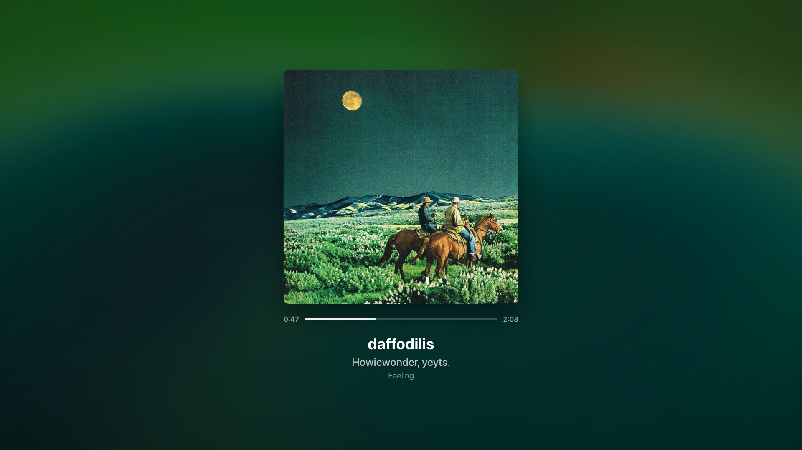

# soloist-display

Spotify Soloist 的安裝與自動更新，加上一個「正在播放」全螢幕畫面：模糊流動的封面背景、專輯封面、進度條、歌名／歌手／專輯，還有逐字亮起的同步歌詞，效果仿照 [Spicy Lyrics](https://github.com/spikerko/spicy-lyrics)。

最初是為社辦的樹莓派（`har`，Raspberry Pi 5，接 4K 電視）做的，Linux、macOS、Windows 都能安裝。




## 需要什麼

- 一把 [Spotify Soloist](https://developer.spotify.com/documentation/soloist) API key（`spak_…`，建立 key 的帳號要有 Premium）。
- Python 3.9 以上（只用標準函式庫，不必 `pip install`）。
- Chrome、Chromium、Edge 或 Brave 其中之一。

Soloist 支援的平台（依 Spotify 文件）：Linux AArch64／ARMv7／x86_64、macOS Apple Silicon（13 以上）、Windows x86_64。執行檔由安裝程式從 Spotify 官方 CDN 下載，不放在這個 repo。

## 安裝

三個平台都是：第一次執行會建立設定檔並停下來，填好 `SOLOIST_API_KEY` 和 `SOLOIST_DEVICE_NAME`（在 Spotify 裡看到的裝置名稱）之後再執行一次。

### Linux（systemd）

```sh
./install.sh            # Soloist + 正在播放畫面
./install.sh soloist    # 只裝 Soloist 與自動更新
./install.sh display    # 只裝正在播放畫面
```

- 設定檔：`~/.config/soloist/soloist.env`
- Soloist 裝在 `/usr/local/bin/soloist`，是使用者服務 `spotify-soloist`；更新程式是 root 的 `soloist-update.timer`（會用到 sudo）。
- 畫面的 server 是使用者服務 `soloist-display`，登入時透過 XDG autostart 開啟畫面。
- 有 apt 時會自動安裝 `chromium`、`fonts-inter`、`wlrctl`、`wtype`；其他發行版請自行安裝瀏覽器，Wayland 另裝 `wlrctl`、`wtype`，X11 裝 `xdotool`。
- 用 labwc 時（Raspberry Pi OS）會加上 Ctrl+Alt+P 快捷鍵。

從開發機部署到 Pi：`./deploy.sh [all|soloist|display]`（同步到 `har:~/apps/soloist-display` 再執行 `install.sh`；`PI=其他主機 ./deploy.sh` 可換目標）。

### macOS（Apple Silicon）

```sh
./install-macos.sh                 # 安裝，登入時開啟畫面
./install-macos.sh --no-autostart  # 不在登入時開啟畫面
./install-macos.sh --uninstall
```

- 設定檔：`~/Library/Application Support/soloist-display/soloist.env`
- Soloist、server、每日更新、開啟畫面都是目前使用者的 LaunchAgent（`org.soloist-display.*`），不需要 sudo。紀錄在 `~/Library/Logs/soloist-display/`。
- 點畫面離開全螢幕需要給 `python3`「輔助使用」權限（系統設定 → 隱私權與安全性 → 輔助使用）；沒給的話按 ⌃⌘F。

### Windows（x86_64）

```powershell
powershell -ExecutionPolicy Bypass -File install.ps1
powershell -ExecutionPolicy Bypass -File install.ps1 -NoAutostart
powershell -ExecutionPolicy Bypass -File install.ps1 -Uninstall
```

- 設定檔：`%APPDATA%\soloist-display\soloist.env`
- Soloist 裝在 `%LOCALAPPDATA%\soloist-display\bin\soloist.exe`。Soloist、server、每日更新、開啟畫面都是工作排程器裡 `\soloist-display\` 下的工作，用 `pythonw` 執行，不會跳出主控台視窗。

## Soloist 自動更新

Soloist 執行檔在發布 90 天後失效（以結束代碼 10 退出），重啟也救不回來，必須換新版。`soloist/update.py` 負責更新：

- 每天 05:30 執行，Linux 另外在開機 3 分鐘後、macOS／Windows 在登入時也會執行。
- 下載這台機器對應的版本，跟已安裝的比對，不同才換：先改名換上新檔（舊版留成 `soloist.prev`），再重啟 Soloist。
- 正在播音樂時會延後，不打斷播放。要立刻更新：Linux 用 `sudo soloist-update --force`，其他平台用 `python3 soloist/update.py --force --restart pid`。
- macOS／Windows 的 Soloist 由 `soloist/run.py` 看管：結束就重啟，遇到失效（代碼 10）會立刻更新再啟動，不必等到隔天。
- Linux 的紀錄：`journalctl -u soloist-update`。

## 正在播放畫面

```
Soloist ──WebSocket──▶ 瀏覽器（全螢幕 app 視窗）
                          ▲
server.py ──HTTP──────────┘  網頁、Soloist 的 WS 位址、歌詞（LRCLIB，有快取）、切換全螢幕
```

- Soloist 以 `--ws 127.0.0.1:0` 開啟本機 WebSocket API，每次啟動埠號都不同；`server.py` 從 Soloist 資料目錄的 `ws.addr`／`ws.port` 讀出來給網頁，斷線時網頁會重新查詢並重連。
- 歌詞來源是 [LRCLIB](https://lrclib.net)（免金鑰）。只有逐行時間軸，所以每個字的亮起時間依字數估算；LRC 若帶 `<mm:ss.xx>` 逐字標記則照實際時間。沒有歌詞或純音樂時，封面移到畫面中央。
- 背景是 [Kawarp](https://github.com/better-lyrics/kawarp)，與 Spicy Lyrics 相同。
- 沒在播放、別的裝置接手、或暫停超過 15 分鐘時，顯示時鐘與裝置名稱。

### 操作

社辦只有滑鼠，所以全部用滑鼠就能操作：

| 動作 | 方式 |
| --- | --- |
| 開機自動開啟 | 自動，全螢幕 |
| 離開全螢幕 | 移動滑鼠會出現「點一下離開全螢幕」，點一下畫面任何地方 |
| 回到全螢幕 | 在視窗裡點一下畫面 |
| 切到其他 App | 離開全螢幕後點工作列，或 Alt+Tab |
| 跳回正在播放 | 點工作列上的視窗、應用程式選單的「正在播放」，或 **Ctrl+Alt+P**（labwc；會一併恢復全螢幕） |

滑鼠停 3 秒後游標與提示會自動隱藏。畫面是用瀏覽器的 `--start-fullscreen` 開的，網頁本身沒辦法離開這種全螢幕，所以點擊時網頁呼叫 `server.py` 的 `POST /api/fullscreen`，由它替瀏覽器按全螢幕鍵：Wayland 用 `wtype`（有 `wlrctl` 時先聚焦視窗）、X11 用 `xdotool`、macOS 用 `osascript` 按 ⌃⌘F、Windows 用 PowerShell 按 F11。都不行時，改用網頁的 Fullscreen API。

`display/open.py` 負責開啟畫面：找到瀏覽器，用獨立的設定檔以 app 模式開啟。畫面已經開著時不會再開一個（在 wlroots 桌面上會直接切到前面）。

### 參數

網址參數（設定環境變數 `SOLOIST_DISPLAY_URL`，或 `open.py --url`）：

- `?offset=300`：歌詞提早 300 ms（負數延後）。
- `?demo&track=…&artist=…&album=…&duration=秒數&cover=封面網址&at=起始秒數`：播放假資料，不連 Soloist，用來調整畫面或截圖。

README 的截圖就是用 demo 模式拍的：

```sh
playwright screenshot --viewport-size=1920,1080 --wait-for-timeout=6000 \
  "http://localhost:8787/?demo&track=iPod%20Touch&artist=Ninajirachi&album=I%20Love%20My%20Computer&duration=197&cover=https%3A//i.scdn.co/image/ab67616d0000b2733b9b742c5c525af6e6767d87&at=37" \
  docs/screenshot-lyrics.jpg
```

### 本機開發

連到 Pi 上正在跑的 Soloist：

```sh
ssh -N -L 45999:127.0.0.1:$(ssh har cat .local/share/soloist/ws.port) har &
mkdir -p /tmp/sol && echo 127.0.0.1 > /tmp/sol/ws.addr && echo 45999 > /tmp/sol/ws.port
SOLOIST_DATA_DIR=/tmp/sol python3 display/server.py --port 8788
# 開 http://localhost:8788/
```

## 目錄

| 路徑 | 內容 |
| --- | --- |
| `install.sh`、`install-macos.sh`、`install.ps1` | Linux、macOS、Windows 安裝程式 |
| `deploy.sh` | 從開發機部署到 Pi |
| `soloist/update.py` | 跨平台更新程式 |
| `soloist/run.py` | macOS／Windows 上看管 Soloist（重啟、失效時更新） |
| `soloist/*.service`、`*.timer` | Linux 的 systemd unit |
| `display/server.py` | 本機 HTTP server |
| `display/open.py` | 開啟或切回畫面 |
| `display/web/` | 正在播放畫面 |
| `pi/` | 社辦 Pi 上其他既有設定的快照（kanshi、labwc、M-AIR Edit 自動啟動） |

## 授權

[MIT](LICENSE)。`display/web/vendor/kawarp.js` 來自 [Kawarp](https://github.com/better-lyrics/kawarp)，同為 MIT（見 `kawarp.LICENSE`）。
Soloist 執行檔屬 Spotify 所有，不包含在這個 repo 裡，由更新程式從官方 CDN 下載。
